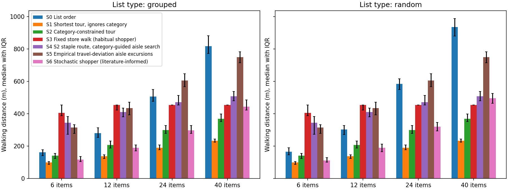
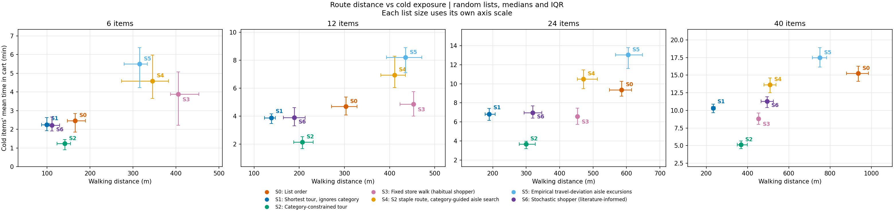
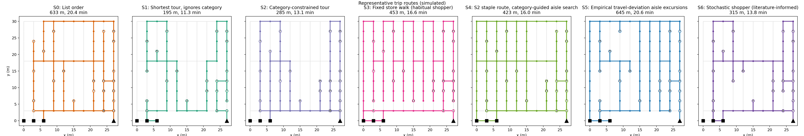

# Grovia Shopping Simulator

An editable supermarket-layout model and Python simulator for comparing shopping-route strategies. The repository includes a Lidl-inspired store graph, a visual layout editor, a reproducible showcase, and the exported data and charts.

[Leggi la versione italiana](README.it.md)

> **Scope:** Every result in this repository is simulated. The store graph, synthetic catalog, shopping lists, routes, shopper profiles, and cold-product exposure are model inputs—not observations of actual Lidl shoppers or measured product temperatures.

## What is included

- `store_sim.py` — simulator CLI; existing JSON store-layout and command-line interfaces are preserved.
- `store_editor.py` — Tkinter editor for creating and editing store-layout JSON. Running it opens `lidl_store_layout.json` when no local `my_store.json` exists.
- `lidl_store_layout.json` — 104-node, 123-edge store graph with three checkout nodes.
- `configs/showcase.json` — the complete configuration used for the showcase.
- `outputs/showcase/Lidl_store/` — raw trials, summaries, sensitivity results, report, representative routes, and simulator-exported PNG charts.

## Setup (Python 3.10+)

Create a virtual environment and install the pinned dependencies:

```powershell
py -3.10 -m venv .venv
.\.venv\Scripts\Activate.ps1
python -m pip install -r requirements.txt
```

On macOS or Linux, use `python3 -m venv .venv` and `source .venv/bin/activate` instead. The visual editor requires Tkinter; it is normally included with the Windows and macOS Python distributions. On Linux, install your distribution's Tkinter package if needed.

Open the included layout in the visual editor:

```text
python store_editor.py
```

Run the simulator help:

```text
python store_sim.py --help
```

The CLI continues to support the existing `--store`, `--catalog`, `--config`, `--export-store`, grid, and output options. A small Lidl run can be made with:

```text
python store_sim.py --store lidl_store_layout.json --n-lists 2 --out smoke-results
```

## Showcase: configuration and regeneration

The committed showcase was generated from the included Lidl layout with seed **42**, **100 lists per size**, and list sizes **6, 12, 24, and 40**. It includes both `random` and `grouped` list orderings: 800 distinct synthetic lists and 5,600 strategy-level trial rows across seven strategies.

The complete configuration—including walking speed, pick time, product mix, S2 group order, S5 calibration, S6 profile weights, and sensitivity ranges—is in [`configs/showcase.json`](configs/showcase.json). Regenerate from the repository root with:

```text
python store_sim.py --store lidl_store_layout.json --config configs/showcase.json --out outputs/showcase
```

The command writes to `outputs/showcase/Lidl_store/`. It replaces the output files there with a fresh run using the saved seed and configuration.

## Strategies

| ID | Strategy | Routing behavior |
|---|---|---|
| S0 | List order | Visits items in written order, using shortest paths between successive stops. |
| S1 | Shortest tour, ignores category | Nearest-neighbor ordering followed by 2-opt improvement. This is a heuristic, not a guarantee of the globally shortest tour. |
| S2 | Category-constrained tour | Uses the configured category-group order, nearest-neighbor ordering, and 2-opt improvement within each group. |
| S3 | Fixed store walk | Follows the layout's fixed serpentine walk and picks listed items as encountered. |
| S4 | Staple route, category-guided aisle search | Visits synthetic staple items first, then searches relevant aisles. |
| S5 | Empirical travel-deviation aisle excursions | Adds aisle excursions to an S1-style purchase order to match an aggregate travel-deviation share. |
| S6 | Stochastic shopper | Samples a focused, familiar, or exploratory behavioral profile and makes probabilistic item choices with possible browsing detours. |

These are routing heuristics and scenario models, not validated predictions of real shopper behavior. In particular, S1 is not an exact traveling-salesperson solver.

## Simulated results and interpretation

The table reports medians for **100 random-order lists of 40 items**. “Cold” is the per-trip mean time that fresh and frozen items spend in the cart, calculated from the simulated walking speed and item-pick time; “frozen” is the corresponding frozen-only mean. The table is a comparison of simulated route and exposure outcomes, not temperature or food-safety measurements.

| Strategy | Walking distance (m) | Cold-item time (min) | Frozen-item time (min) |
|---|---:|---:|---:|
| S0 | 936.0 | 15.26 | 15.39 |
| S1 | 234.0 | 10.33 | 7.82 |
| S2 | 369.0 | 5.12 | 1.71 |
| S3 | 453.0 | 8.82 | 10.74 |
| S4 | 508.5 | 13.66 | 9.51 |
| S5 | 750.0 | 17.48 | 13.58 |
| S6 | 495.0 | 11.31 | 10.79 |

On these 40-item random lists, S1 has the lowest median walking distance (234 m). S2's category order increases the median distance to 369 m while lowering median cold-item time from 10.33 to 5.12 minutes and frozen-item time from 7.82 to 1.71 minutes. This is the main distance-versus-cold-exposure tradeoff in this scenario: delaying fresh and frozen categories can shorten their time in the cart, but it does not minimize total walking. S5's aggregate-deviation excursions are longer in this run (750 m median) and have the highest median cold exposure (17.48 minutes). These are scenario-specific outcomes; the full results cover all four list sizes and both list types.

### Distance by strategy

[](outputs/showcase/Lidl_store/distance_by_strategy.png)

*Figure 1. Simulated walking distance by strategy and list size, shown separately for grouped and random lists. Settings: Lidl layout, seed 42, 100 lists per size and list type, sizes 6/12/24/40; bars show medians and interquartile ranges. S1 is shortest in the displayed comparisons, while S2 trades some distance for a category-ordered route.*

[Open the full-size distance chart](outputs/showcase/Lidl_store/distance_by_strategy.png).

### Distance versus cold-product exposure

[](outputs/showcase/Lidl_store/tradeoff_distance_vs_cold.png)

*Figure 2. Simulated walking distance versus mean cold-item time in the cart for random lists. Settings: same Lidl layout, seed, list counts, and sizes as Figure 1; points show medians and error bars show interquartile ranges. Each list-size panel has its own axis scale. S2's category constraint moves toward lower cold exposure than S1, at the cost of a longer route.*

[Open the full-size tradeoff chart](outputs/showcase/Lidl_store/tradeoff_distance_vs_cold.png).

### Representative routes on the store map

[](outputs/showcase/Lidl_store/representative_trips.png)

*Figure 3. Simulator-exported physical routes for one representative 24-item random list (seed 42, selection 0), plotted on the included store graph. The seven panels use the same list; route length and estimated total trip time are shown in each panel. This single list illustrates how route patterns differ—it is not a median or a typicality claim.*

[Open the full-size representative-route chart](outputs/showcase/Lidl_store/representative_trips.png) · [View the representative route data](outputs/showcase/Lidl_store/representative_trip.json) · [Read the route text](outputs/showcase/Lidl_store/representative_trip.txt).

### Download the underlying results

- [Trial-level CSV (5,600 rows)](outputs/showcase/Lidl_store/trials.csv)
- [Summary CSV (medians and interquartile ranges)](outputs/showcase/Lidl_store/summary.csv)
- [Sensitivity CSV](outputs/showcase/Lidl_store/sensitivity.csv)
- [Simulator report](outputs/showcase/Lidl_store/report.txt)
- [Store layout chart](outputs/showcase/Lidl_store/layout.png) · [Node-visit heatmaps](outputs/showcase/Lidl_store/heatmaps.png)

## Model assumptions and limitations

- The Lidl layout is an editable graph abstraction; nodes and edges represent modeled shopping locations and walkable segments, not a surveyed or officially supplied store plan.
- The catalog, category mix, staple flags, and shopping lists are synthetic. A `grouped` list is sorted by category; a `random` list is shuffled.
- Distance is measured along weighted graph edges. S1/S2 use nearest-neighbor and 2-opt heuristics, so “shortest tour” is a strategy label rather than a proof of optimality.
- Cold exposure is an estimated time-in-cart proxy derived from route progress, walking speed, and pick time. The simulation does not model product temperatures, refrigeration, ambient conditions, or food safety.
- **S5 aggregate calibration:** the configuration targets a 69% travel-deviation share using an aggregate mean path-decomposition share reported in [SSRN 942570](https://papers.ssrn.com/sol3/papers.cfm?abstract_id=942570). It turns that aggregate calibration into simulated aisle excursions; it is not fitted to individual trips or to this Lidl layout.
- **S6 assumed behavioral profiles:** the focused/familiar/exploratory profile weights (55%/30%/15%) and behavior strengths are scenario assumptions, not estimates from the cited research. The profiles influence item choice and possible aisle detours; incidental purchases and shelf-level consideration are not modeled.

## License

No reuse license is included. All results and images are generated by the simulator from the saved configuration.
